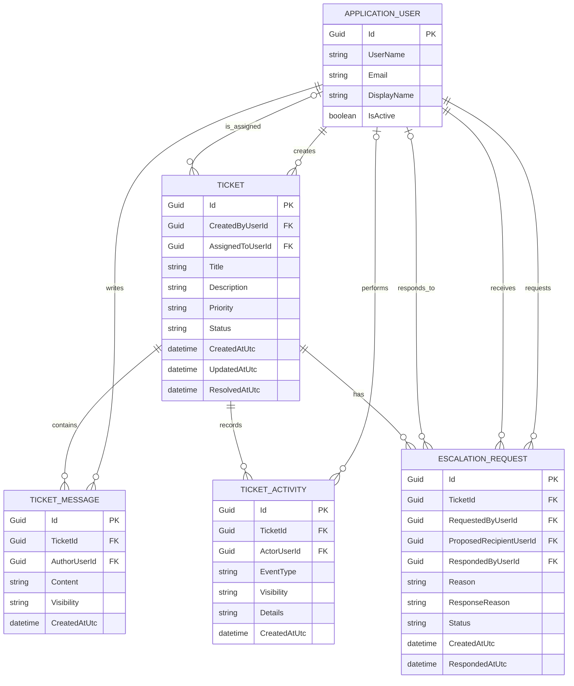

# Database Schema

## 1. Purpose
This document represents the current iteration of the helpdesk application's database model. It contains the entity relationship diagram 
(ERD), the responsibilities of each entity, and the reasoning behind key design decisions.

## 2. Entity Relationship Diagram

## 3. Entities 

### 3.1 ApplicationUser
**Purpose:** Represents a user account within the application.

**Key responsibilities:**
- Stores helpdesk-specific user profile information.
- Integrates with ASP.NET Core Identity for authentication and role management, by inheriting from 

**Design decisions:**
- Uses ASP.NET Core Identity rather than a custom authentication implementation.
- Uses Guid identifiers consistently with the other entities.

### 3.2 Ticket
**Purpose:** Represents a ticket a customer has submitted within the application, and its current state.

**Design decisions:**
- Assignment is optional so tickets can exist in an unassigned queue.
- The current ticket state is stored separately from its historical activity.

### 3.3 TicketMessage
**Purpose:** Represents a message or internal note linked to a specified ticket. 

**Design decisions:**
- Separates conversation content from ticket activity.
- Uses a visibility attribute to distinguish public replies from internal notes.

### 3.4 TicketActivity
**Purpose:** Records notable events and changes for a specified ticket.

**Design decisions:**
- Provides a historical record of events such as assignment changes, status updates, and escalation outcomes.
- Supports different visibility levels for customer-facing and internal events.

### 3.5 EscalationRequest
**Purpose:** Represents a supports agent's request to reassign a ticket to a more qualified agent. 

**Design decisions:**
- Models escalation as a separate process with its own status.
- Retains previous requests so rejected and completed escalations remain part of the history.

## 4. Relationships and Business Rules

## 5. Technology and Implementation Decisions

## 6. Open Questions
