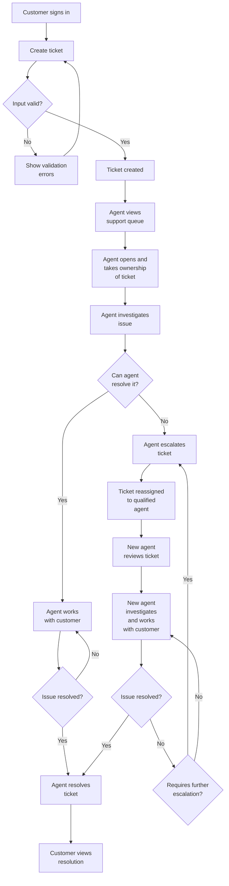

# Helpdesk Workflow
This document defines the expected workflows of this platform, making it easier to plan out required features. 

## Main workflow
A customer submits a ticket, and a support agent attempts to resolve it. 

### Diagram

